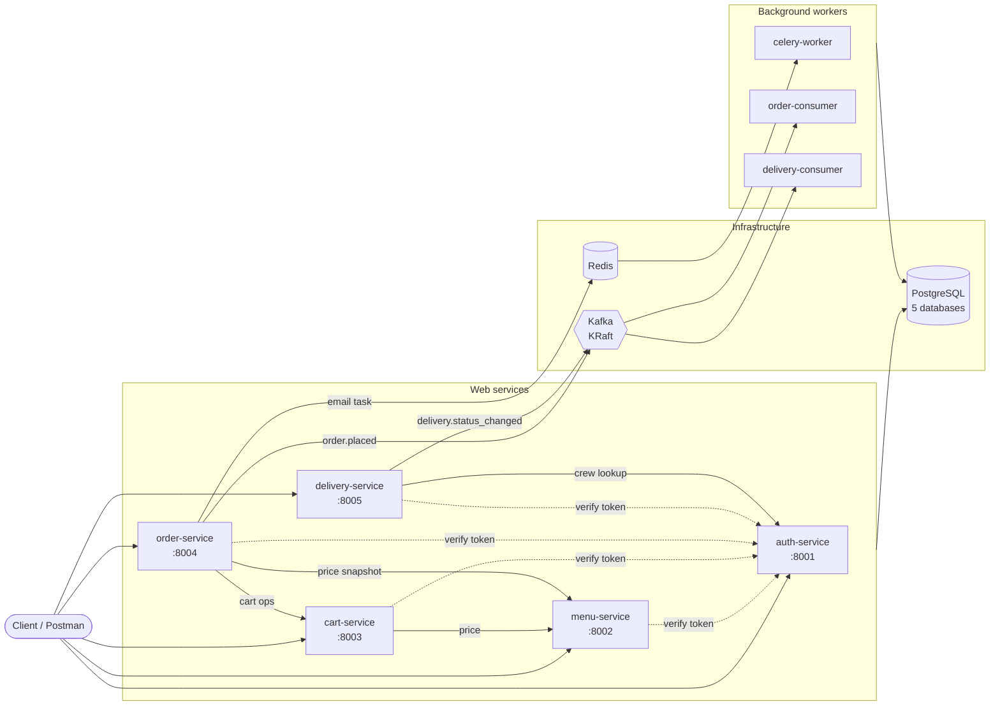
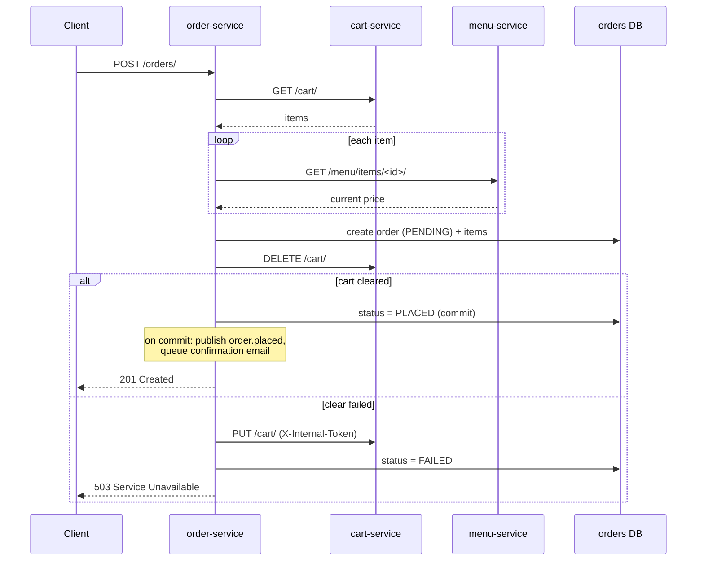

# 🍽️ Restaurant Microservices

A restaurant ordering backend built as five independent Django REST services, wired together with HTTP, Kafka events and Celery tasks, and run with a single `docker compose up`.


---

Decomposed from a monolithic Django REST application into five independent services, each owning its own data and communicating over HTTP and Kafka.

### ✨ Highlights

| | |
| --- | --- |
| 🧱 **Service decomposition** | One database per service, no cross-database foreign keys |
| 🔐 **Centralised authentication** | A shared package verifies every request against the auth service |
| 🔁 **Orchestrated saga** | Order placement across three services, with compensation on failure |
| 📨 **Event-driven integration** | Orders and deliveries stay in sync through Kafka |
| ⏳ **Background work** | Confirmation emails sent by Celery workers through Redis |
| 🐳 **One-step setup** | 12 Compose services, zero configuration: migrations and demo data applied on start |

---

## 📑 Contents

- [🧩 Architecture](#-architecture)
- [📦 Services](#-services)
- [🧰 Tech stack](#-tech-stack)
- [📁 Repository layout](#-repository-layout)
- [🚀 Getting started](#-getting-started)
- [📡 API reference](#-api-reference)
- [🔄 Core flows](#-core-flows)
- [📨 Event contracts](#-event-contracts)
- [🔐 Authentication and authorisation](#-authentication-and-authorisation)
- [🔧 Configuration](#-configuration)
- [💻 Running without Docker](#-running-without-docker)
- [📐 Design decisions and trade-offs](#-design-decisions-and-trade-offs)
- [📋 Useful commands](#-useful-commands)

---

## 🧩 Architecture



- **Synchronous calls (HTTP)** are used where the caller needs an answer now: token verification, price lookups and cart operations during checkout.
- **Asynchronous events (Kafka)** connect order and delivery. Neither calls the other over HTTP; each reacts to the other's events.
- **Background tasks (Celery + Redis)** send the order confirmation email outside the request.

## 📦 Services

| Service | Port | Database | Responsibility |
| --- | --- | --- | --- |
| 🔑 `auth-service` | 8001 | `restaurant_auth` | Users, roles, JWT issue, refresh, logout (blacklist) and token verification |
| 🍽️ `menu-service` | 8002 | `restaurant_menu` | Categories and menu items; the source of truth for prices |
| 🛒 `cart-service` | 8003 | `restaurant_cart` | One cart per user; prices fetched from menu, totals computed server-side |
| 🧾 `order-service` | 8004 | `restaurant_orders` | Places orders through the saga; publishes `order.placed`; queues confirmation emails |
| 🛵 `delivery-service` | 8005 | `restaurant_delivery` | Deliveries, crew assignment and status transitions; publishes `delivery.status_changed` |

### Supporting containers

| Container | Built from | Role |
| --- | --- | --- |
| 🐘 `db` | `postgres:17` | One server hosting all five databases |
| 🧠 `redis` | `redis:7-alpine` | Celery message broker |
| 📨 `kafka` | `apache/kafka:4.0.0` | Event broker in KRaft mode (no ZooKeeper) |
| 🏁 `kafka-init` | `apache/kafka:4.0.0` | One-off job that creates the topics, then exits |
| ✉️ `celery-worker` | order image | Runs `send_order_confirmation_email` |
| 📥 `delivery-consumer` | delivery image | Consumes `order.placed`, creates `UNASSIGNED` deliveries |
| 📥 `order-consumer` | order image | Consumes `delivery.status_changed`, updates order status |

## 🧰 Tech stack

| Area | Technology | Details |
| --- | --- | --- |
| Language |  | Python 3.14 |
| Framework |   | Django 6.1, Django REST Framework 3.18 |
| Auth |  | djangorestframework-simplejwt 5.5 (access + refresh tokens, blacklist) |
| Database |  | PostgreSQL 17 (psycopg2) |
| Events |  | Apache Kafka 4.0 (KRaft), confluent-kafka 2.16 |
| Background tasks |   | Celery 5.6, Redis 7 |
| Configuration |  | Settings from environment variables; Compose supplies development defaults |
| Containers |  | Docker, Docker Compose |
| API testing |  | Manual end-to-end testing of every endpoint |

## 📁 Repository layout

```
restaurant-microservices/
├── auth_service/           # Django project: authentication app
├── menu_service/           # Django project: menu app
├── cart_service/           # Django project: cart app
├── order_service/          # Django project: order app, Celery app, Kafka producer + consumer
├── delivery_service/       # Django project: delivery app, Kafka producer + consumer
├── remote-auth/            # Shared pip package: RemoteJWTAuthentication + permissions
├── docker/
│   └── entrypoint.sh       # Runs migrations and seed data (when enabled), then starts the container's command
├── postgres/
│   └── init/
│       └── 01-create-databases.sql   # Creates the menu, cart, orders and delivery databases
├── kafka/
│   └── create_topics.sh    # Topic creation for a standalone (non-Compose) Kafka container
├── docker-compose.yml      # Full stack, with development defaults for every setting
├── requirements.txt        # Shared dependencies for every service
├── .dockerignore
└── .gitignore
```

Each service folder contains its own `Dockerfile`, `manage.py` and `.env.example`. The `.env.example` files are only needed when [running without Docker](#-running-without-docker).

Seed commands live with the app that owns the data: `seed_users` in auth and `seed_menu` in menu, under `<app>/management/commands/`.

---

## 🚀 Getting started

### Prerequisites

- Docker with Docker Compose v2 (Docker Desktop on macOS or Windows)
- Free host ports: 8001–8005, 5433 and 9092

### 1. Clone

```bash
git clone https://github.com/syed-anas-a/restaurant-microservices.git
cd restaurant-microservices
```

### 2. Start the stack

```bash
docker compose up --build
```

No configuration is needed. Every setting has a development default in `docker-compose.yml`, so there are no `.env` files to create. On first start:

1. Postgres creates the five databases.
2. Kafka starts, and `kafka-init` creates the topics.
3. Each web service applies its migrations.
4. Auth seeds one user per role, and menu seeds sample categories and items.
5. All services start.

> [!TIP]
> `docker compose ps` should show 11 running containers and `kafka-init` as exited (0). That exit is expected: it creates the topics and stops.

> [!WARNING]
> The defaults, including the seeded passwords, are insecure and meant for local development only. See [Configuration](#-configuration) for how to override them.

### 3. Log in with a seeded account

| Role | Email | Password |
| --- | --- | --- |
| Manager | `manager@restaurant.local` | `restaurant123` |
| Delivery crew | `crew@restaurant.local` | `restaurant123` |
| Customer | `customer@restaurant.local` | `restaurant123` |

The menu starts with 4 categories and 24 items.

Seeding is idempotent: it runs on every start but only creates rows that do not exist yet, so restarts never duplicate data and changes made through the API are kept.

> [!NOTE]
> Registration through `/auth/register/` always creates a `CUSTOMER`. The seeded manager and crew accounts are the only accounts with those roles; there is no API for promoting a user.

### 4. Try the full flow

1. Log in as each seeded user: `POST localhost:8001/auth/login/`
2. As customer, browse the menu: `GET localhost:8002/menu/`
3. As customer, add an item to the cart: `POST localhost:8003/cart/`
4. As customer, place the order: `POST localhost:8004/orders/`
5. Check the `celery-worker` logs for the confirmation email, and `GET localhost:8005/deliveries/` as manager for the new `UNASSIGNED` delivery
6. As manager, assign the crew member (look up their ID with `GET localhost:8001/auth/users/`): `PATCH localhost:8005/deliveries/<id>/`
7. As crew, move the delivery to `OUT FOR DELIVERY`, then `DELIVERED`, and watch the order status follow

---

## 📡 API reference

All protected endpoints expect `Authorization: Bearer <access token>`.

### 🔑 Auth — `localhost:8001`

| Method | Path | Access | Description |
| --- | --- | --- | --- |
| POST | `/auth/register/` | Public | Create a user (`email`, `password`, `first_name`, `last_name`); returns the user plus access and refresh tokens |
| POST | `/auth/login/` | Public | `email` + `password` → `access` (60 min) and `refresh` (20 days) |
| POST | `/auth/login/refresh/` | Public | `refresh` → new `access` |
| POST | `/auth/logout/` | Authenticated | Blacklists the given `refresh` token |
| GET | `/auth/users/` | Manager | List all users |
| GET | `/auth/users/<id>/` | Owner or manager | Get a user |
| PUT | `/auth/users/<id>/` | Owner or manager | Update a user (`group` is read-only) |
| DELETE | `/auth/users/<id>/` | Owner or manager | Delete a user |
| POST | `/auth/verify/` | Internal | `token` → `user_id`, `group`, `email`; used by every other service |

### 🍽️ Menu — `localhost:8002`

| Method | Path | Access | Description |
| --- | --- | --- | --- |
| GET | `/menu/` | Public | List menu items |
| POST | `/menu/` | Manager | Create a menu item (`title`, `price`, `description`, `category`, optional `image`) |
| GET | `/menu/items/<id>/` | Public | Get a menu item |
| PUT | `/menu/items/<id>/` | Manager | Replace a menu item |
| DELETE | `/menu/items/<id>/` | Manager | Delete a menu item |
| GET | `/menu/categories/` | Public | List categories |
| POST | `/menu/categories/` | Manager | Create a category (`name`, `cuisine`) |
| GET | `/menu/categories/<id>/` | Public | Get a category |
| PUT | `/menu/categories/<id>/` | Manager | Replace a category |
| DELETE | `/menu/categories/<id>/` | Manager | Delete a category; its items keep a null category |

### 🛒 Cart — `localhost:8003`

| Method | Path | Access | Description |
| --- | --- | --- | --- |
| GET | `/cart/` | Authenticated | The caller's cart with items and server-computed `total` |
| POST | `/cart/` | Authenticated | Add an item: `menu_item_id`, `quantity` (default 1); price is fetched from menu |
| DELETE | `/cart/` | Authenticated | Clear the cart |
| PUT | `/cart/` | Authenticated + internal token | Restore cart items (saga compensation); requires `X-Internal-Token` |
| PATCH | `/cart/items/<menu_item_id>/` | Authenticated | Set an item's `quantity` |
| DELETE | `/cart/items/<menu_item_id>/` | Authenticated | Remove an item |

The client never sends a price. Adding an item that is already in the cart increases its quantity and refreshes its price.

### 🧾 Orders — `localhost:8004`

| Method | Path | Access | Description |
| --- | --- | --- | --- |
| GET | `/orders/` | Authenticated | The caller's orders with items |
| POST | `/orders/` | Authenticated | Place an order from the caller's cart (runs the saga) |
| GET | `/orders/<id>/` | Owner or manager | Get an order |
| PATCH | `/orders/<id>/` | Manager | Set `status` |

Order statuses: `PENDING`, `PLACED`, `FAILED`, `PREPARING`, `OUT FOR DELIVERY`, `DELIVERED`, `CANCELLED`.

### 🛵 Deliveries — `localhost:8005`

| Method | Path | Access | Description |
| --- | --- | --- | --- |
| GET | `/deliveries/` | Authenticated | Manager sees all; crew sees assigned; customer sees own |
| GET | `/deliveries/<id>/` | Scoped as above | Get a delivery |
| PATCH | `/deliveries/<id>/` | Manager | Assign or reassign crew: `crew_id` |
| PATCH | `/deliveries/<id>/status/` | Assigned crew | Advance `status` |

Deliveries are never created through the API; they are created by `delivery-consumer` from `order.placed` events.

Delivery status transitions:

```
UNASSIGNED → ASSIGNED → OUT FOR DELIVERY → DELIVERED
```

Assignment rules:

- Only `UNASSIGNED` or `ASSIGNED` deliveries can be (re)assigned.
- The user must belong to the `DELIVERY CREW` group (checked against auth).
- A crew member can hold only one active (not yet delivered) delivery.

---

## 🔄 Core flows

### Order placement saga

Order placement spans three services, so it cannot be one database transaction. `order-service` orchestrates it as a saga:



1. **Fetch the cart** from cart-service. An empty cart returns 400.
2. **Snapshot prices** from menu-service, so the order records what the customer actually paid even if the menu changes later.
3. **Create the order as `PENDING`** with its items, in one local transaction.
4. **Clear the cart.**
5. **Confirm:** mark the order `PLACED`. After the commit, publish `order.placed` and queue the email.

**Compensation:** if clearing the cart fails, order-service restores the cart from its snapshot through the internal-token-protected `PUT /cart/` and marks the order `FAILED`. If the restore also fails, the response reports that the cart could not be restored.

### Event flow between orders and deliveries

1. `order-service` publishes `order.placed` after the order commits.
2. `delivery-consumer` creates an `UNASSIGNED` delivery (idempotent `get_or_create` on `order_id`).
3. A manager assigns crew; `delivery-service` publishes `delivery.status_changed` (`ASSIGNED`).
4. `order-consumer` records `delivery_crew_id` on the order.
5. The crew member moves the delivery to `OUT FOR DELIVERY` and `DELIVERED`; each change is published, and `order-consumer` advances the order with conditional updates.

### Confirmation email

1. After the order commits, `order-service` calls `send_order_confirmation_email.delay(order_id, email)`.
2. The task message goes to Redis; the request returns immediately.
3. `celery-worker` loads the order and sends the email. With the default console backend, the email is printed in the worker's logs.
4. Transient `OSError` failures retry with exponential backoff, up to five times.

---

## 📨 Event contracts

Every event shares one envelope:

```json
{
  "event_id": "8f6c2a1e-...",
  "event_type": "order.placed",
  "occurred_at": "2026-10-22T10:15:30.123456+00:00",
  "data": { }
}
```

| Topic | Producer | Consumer group | Key | `data` |
| --- | --- | --- | --- | --- |
| `order.placed` | order-service | `delivery-service` | `order_id` | `order_id`, `customer_id` |
| `delivery.status_changed` | delivery-service | `order-service` | `order_id` | `order_id`, `delivery_id`, `crew_id`, `status` |

- **Partitions:** 3 per topic. Keying by `order_id` sends every event for one order to the same partition, so its status changes are consumed in order.
- **Publishing:** events are produced in `transaction.on_commit`, so a rolled-back change is never announced. The producer uses `acks=all`.
- **Consuming:** auto-commit is disabled; offsets are committed after each message is handled, giving at-least-once delivery. Both handlers are idempotent, so a re-delivered message has no extra effect.

How `order-consumer` maps delivery status to order state:

| Delivery status | Effect on the order |
| --- | --- |
| `ASSIGNED` | Sets `delivery_crew_id`, unless the order is `CANCELLED` or `FAILED` |
| `OUT FOR DELIVERY` | `PLACED` or `PREPARING` → `OUT FOR DELIVERY` |
| `DELIVERED` | `OUT FOR DELIVERY` → `DELIVERED` |

---

## 🔐 Authentication and authorisation

### User tokens

1. `auth-service` issues JWTs with SimpleJWT.
2. Every other service uses `remote_auth.authentication.RemoteJWTAuthentication`, from the shared `remote-auth` package.
3. On each request it sends the bearer token to `auth-service` at `/auth/verify/` and receives `user_id`, `group` and `email`.
4. It builds a lightweight `ServiceUser` as `request.user`. No service other than auth has a user table.

Because the group is looked up on every request, a role change applies immediately.

### Roles

| Group | Can |
| --- | --- |
| `CUSTOMER` | Browse the menu, manage their cart, place and view their orders, view their deliveries |
| `MANAGER` | Manage the menu, list users, view any order, set order status, view all deliveries, assign crew |
| `DELIVERY CREW` | View and advance the deliveries assigned to them |

### Service-to-service token

The cart restore endpoint (`PUT /cart/`) must not be callable by customers, because it writes prices. It requires both a valid user token and an `X-Internal-Token` header matching `INTERNAL_SERVICE_TOKEN`, a secret shared only by cart and order.

---

## 🔧 Configuration

Each service reads its settings from environment variables with `python-decouple`. Where those values come from depends on how you run it:

- **With Docker:** `docker-compose.yml` sets every variable, with a development default for anything that could change between environments. No `.env` file is required.
- **Without Docker:** each service reads its own `<service>/.env`, created from `<service>/.env.example`.

### Overriding the Docker defaults

Compose writes overridable values as `${VAR:-default}`: it uses `VAR` from your shell or from a `.env` file at the repository root if one is set, and the default otherwise. To override any of them, create a root `.env` containing only the variables you want to change:

```env
POSTGRES_PASSWORD=a-strong-password
AUTH_SECRET_KEY=a-long-random-string
SEED_DATA=0
```

| Variable | Default | Used by |
| --- | --- | --- |
| `POSTGRES_USER` | `postgres` | `db` and every Django container (as `DB_USER`) |
| `POSTGRES_PASSWORD` | `postgres` | `db` and every Django container (as `DB_PASSWORD`) |
| `AUTH_SECRET_KEY` … `DELIVERY_SECRET_KEY` | `dev-insecure-<service>-secret-key` | Each service, as its `SECRET_KEY` |
| `INTERNAL_SERVICE_TOKEN` | `dev-internal-service-token` | cart and order; defined once, so the two always match |
| `DEBUG` | `True` | Every Django container |
| `SEED_DATA` | `1` | auth and menu; `0` disables seeding |
| `SEED_PASSWORD` | `restaurant123` | Password for the three seeded users |
| `EMAIL_USE_SMTP` | `False` | order; `True` sends through Gmail SMTP instead of printing to the console |
| `SMTP_USER`, `SMTP_PASSWORD` | empty | order, when `EMAIL_USE_SMTP=True` |
| `DEFAULT_FROM_EMAIL` | `orders@restaurant.local` | order |

Generate random values with:

```bash
python -c "import secrets; print(secrets.token_urlsafe(32))"
```

> [!IMPORTANT]
> Postgres applies `POSTGRES_USER` and `POSTGRES_PASSWORD` only when it initialises an empty volume. After changing them, run `docker compose down -v` so the database is recreated with the new credentials.

> [!IMPORTANT]
> A root `.env` holding real values is excluded by `.gitignore` and `.dockerignore`. Never commit it.

### Fixed values set by Compose

These describe the container network and never need overriding:

| Variable | Value in Docker |
| --- | --- |
| `DB_HOST`, `DB_PORT` | `db`, `5432` |
| `DB_NAME` | `restaurant_auth`, `restaurant_menu`, `restaurant_cart`, `restaurant_orders`, `restaurant_delivery` |
| `ALLOWED_HOSTS` | `localhost,127.0.0.1` plus the service's own name, e.g. `menu-service` |
| `*_SERVICE_URL` | `http://<name>-service:800x` |
| `CELERY_BROKER_URL` | `redis://redis:6379/0` |
| `KAFKA_BOOTSTRAP_SERVERS` | `kafka:29092` |
| `RUN_MIGRATIONS` | `1` on the five web services only |
| `SEED_COMMAND` | `seed_users` on auth, `seed_menu` on menu |

Services that run the same code share one environment definition through YAML anchors: `order-service`, `celery-worker` and `order-consumer` all use `x-order-env`, and the two delivery containers use `x-delivery-env`. A change to the order environment therefore applies to all three at once.

### All settings read by the services

| Variable | Services | Description |
| --- | --- | --- |
| `SECRET_KEY` | all | Django secret key |
| `DEBUG` | all | `True` or `False` |
| `ALLOWED_HOSTS` | all | Comma-separated host names |
| `DB_NAME`, `DB_USER`, `DB_PASSWORD`, `DB_HOST`, `DB_PORT` | all | PostgreSQL connection |
| `AUTH_SERVICE_URL` | menu, cart, order, delivery | Base URL of auth-service |
| `MENU_SERVICE_URL` | cart, order | Base URL of menu-service |
| `CART_SERVICE_URL` | order | Base URL of cart-service |
| `INTERNAL_SERVICE_TOKEN` | cart, order | Shared secret for the cart restore endpoint; must match |
| `CELERY_BROKER_URL` | order | Redis URL for Celery |
| `KAFKA_BOOTSTRAP_SERVERS` | order, delivery | Kafka bootstrap address |
| `EMAIL_USE_SMTP` | order | `True` to send through Gmail SMTP; `False` prints emails to the console |
| `SMTP_USER`, `SMTP_PASSWORD` | order | SMTP credentials when `EMAIL_USE_SMTP=True` |
| `DEFAULT_FROM_EMAIL` | order | Sender address |
| `SEED_PASSWORD` | auth | Password for seeded users (seed command only) |

### Ports

| Service | Inside the Compose network | From the host |
| --- | --- | --- |
| auth, menu, cart, order, delivery | `<name>-service:8001`–`8005` | `localhost:8001`–`8005` |
| PostgreSQL | `db:5432` | `localhost:5433` |
| Redis | `redis:6379` | not published |
| Kafka | `kafka:29092` | `localhost:9092` |

Kafka runs two client listeners because a client reconnects to the address the broker *advertises*: containers are told `kafka:29092`, and tools on the host are told `localhost:9092`.

---

## 💻 Running without Docker

Requirements: Python 3.14, PostgreSQL with the five databases, Redis on 6379, and Kafka on 9092.

```bash
python -m venv .venv
source .venv/bin/activate
pip install -r requirements.txt
```

For each service, create its `.env` from `.env.example` and fill in `SECRET_KEY`, the database credentials, and (for cart and order) the same `INTERNAL_SERVICE_TOKEN`. Then:

```bash
cd auth_service
python manage.py migrate
python manage.py runserver 8001
```

To load the demo data, run `python manage.py seed_users` in `auth_service` and `python manage.py seed_menu` in `menu_service` after migrating.

Repeat for menu (8002), cart (8003), order (8004) and delivery (8005). Then start the background processes, each in its own terminal:

```bash
cd order_service && celery -A order_service worker -l info
cd order_service && python manage.py consumer_delivery_events
cd delivery_service && python manage.py consume_order_events
```

If Kafka runs as a standalone container named `kafka`, `kafka/create_topics.sh` creates the topics.

---

## 📐 Design decisions and trade-offs

### ✅ Implemented deliberately

- **Database per service.** Services reference each other's records by ID only (`user_id`, `menu_item_id`, `order_id`); there are no cross-database foreign keys.
- **Price snapshots.** Cart and order store the price at the time of the action, so later menu changes never alter a past order.
- **Server-side totals.** Clients send item IDs and quantities only.
- **Orchestrated saga** instead of a distributed transaction, with explicit compensation.
- **At-least-once consumers with idempotent handlers**, giving effectively-once results.
- **Ordered events per order** through keying by `order_id`.
- **Idempotent seeding.** Seed commands only create missing rows, so they run safely on every start and never overwrite changes made through the API.
- **Migrations run by exactly one container per database** (the web service), avoiding concurrent migration races with the workers that share it.

### ⚠️ Accepted limitations

> [!WARNING]
> **Dual write.** An order is committed to the database and then published to Kafka. If Kafka is down, or the process stops between the two, the event is lost. A transactional outbox would close this gap; it is intentionally out of scope.

- **Insecure development defaults.** The compose file ships default secrets and seeded passwords so the stack runs with no configuration. They are labelled `dev-insecure` and must be overridden anywhere beyond a local machine; in production, configuration would come from a secret manager rather than the compose file.
- **Seeding relies on non-unique fields.** `Category.name` and `Menu.title` are not unique in the database, so a duplicate created through the API would make the seed fail on the next start.
- **One database superuser** owns all five databases. Production would use one user per service.
- **No persistent volumes for Redis or Kafka.** `docker compose down` discards queued emails, unconsumed events and consumer offsets. PostgreSQL data persists in the `postgres_data` volume.
- **Development server.** The web services run Django's `runserver`.
- **Payment** is not implemented.

---

## 📋 Useful commands

| Command | Purpose |
| --- | --- |
| `docker compose up --build` | Build and start everything |
| `docker compose ps` | Container status and health |
| `docker compose logs -f <service>` | Follow a service's logs |
| `docker compose exec <service> python manage.py <cmd>` | Run a Django command in a service |
| `docker compose down` | Stop and remove containers; keep database data |
| `docker compose down -v` | Also delete database data |
| `docker compose exec auth-service python manage.py seed_users` | Re-run the user seed manually |
| `docker compose exec menu-service python manage.py seed_menu` | Re-run the menu seed manually |
| `docker compose exec db psql -U postgres -l` | List databases |
| `docker compose exec kafka /opt/kafka/bin/kafka-topics.sh --list --bootstrap-server kafka:29092` | List topics |
| `docker compose exec kafka /opt/kafka/bin/kafka-consumer-groups.sh --describe --all-groups --bootstrap-server kafka:29092` | Consumer offsets and lag |